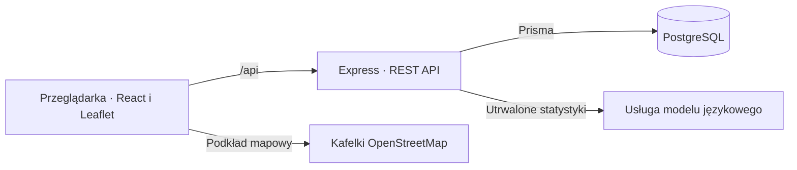

# Architektura aplikacji

Zatwierdzony układ obejmuje frontend React, modularny backend Express i PostgreSQL. Zakres pierwszego importu ogranicza się do śladów GPX 1.1 (`trk`).

## Podział odpowiedzialności

Kod Reacta i Expressa znajduje się w jednym repozytorium zarządzanym przez npm workspaces. React prezentuje dane oraz wysyła żądania do REST API. Express sprawdza sesję i uprawnienia, przetwarza GPX, oblicza statystyki i koordynuje generowanie opisów. PostgreSQL utrwala dane. Na wdrożeniu przeglądarka widzi frontend i `/api` pod tym samym originem. Lokalnie Vite przekazuje żądania `/api` do Expressa przez proxy deweloperskie. [npm workspaces](https://docs.npmjs.com/cli/v11/using-npm/workspaces)

`GET /api/health` wykonuje `SELECT 1` przez sterownik `pg`. Moduł kont uzyskuje dostęp do tej samej puli PostgreSQL przez adapter Prisma 7. Schemat i pierwsza migracja definiują `User` oraz `Session`.

Konfiguracja npm przypina poprawioną wersję `effect` dla zależności Prisma CLI. Przy aktualizacji Prisma sprawdzimy, czy pakiet sam wskazuje wersję z poprawką. [Zgłoszenie Effect](https://github.com/advisories/GHSA-7589-6fvf-x4pw)



### Struktura katalogów docelowych

```text
cycling-gpx-app/
├── apps/
│   ├── web/
│   │   └── src/
│   │       ├── app/               # konfiguracja aplikacji i nawigacja
│   │       ├── features/          # auth, routes, descriptions
│   │       └── lib/               # klient HTTP i współdzielona konfiguracja UI
│   └── api/
│       ├── prisma/               # schemat i migracje
│       ├── src/
│       │   ├── app.ts            # instancja Expressa do uruchamiania i testów
│       │   ├── server.ts         # konfiguracja i nasłuchiwanie HTTP
│       │   ├── modules/          # auth, routes, gpx, descriptions
│       │   └── infrastructure/   # połączenie z bazą i konfiguracja środowiska
│       └── test/
│           ├── fixtures/         # syntetyczne próbki GPX
│           └── integration/
├── packages/
│   └── contracts/                # typy DTO przy pierwszym wspólnym kontrakcie
├── docs/
│   ├── decisions/
│   ├── api/
│   └── research/
├── AGENTS.md
├── PROJECT.md
├── ARCHITECTURE.md
├── ROADMAP.md
├── README.md
├── compose.yaml
└── package.json
```

W obrębie modułu handler HTTP waliduje dane wejściowe i przekazuje je do funkcji realizującej operację. Parser, kalkulator statystyk i generator regułowy mają niezależne wejścia i wyjścia, aby można je było testować bez HTTP i bazy. Modele Prisma pozostają wewnątrz API. Wspólne DTO opisują dane przesyłane między API i frontem. Dane z granic systemu, w tym GPX, JSON żądań i odpowiedzi modelu, wymagają walidacji w czasie działania.

## Konto i sesja

Rejestracja tworzy konto i pierwszą sesję w jednej operacji. Logowanie i rejestracja zwracają publiczne dane konta oraz ciasteczko `HttpOnly` z losowym tokenem ważnym przez siedem dni. Baza utrwala skrót SHA-256 tokenu oraz skrót hasła Argon2id. Operacje na koncie wyprowadzają identyfikator użytkownika z aktywnej sesji i wymagają podania bieżącego hasła. Zmiana hasła zapisuje nowy skrót i odwołuje wszystkie sesje w tej samej transakcji. Utworzenie sesji po logowaniu jest synchronizowane na rekordzie użytkownika, aby równoległa zmiana danych logowania nie pozostawiła nowej sesji ze starymi poświadczeniami. Usunięcie konta usuwa sesje przez klucz obcy.

Wszystkie operacje zmieniające stan sprawdzają `Origin` według dozwolonych adresów frontendu. Ciasteczko używa `SameSite=Lax`, a przez produkcyjne HTTPS także `Secure`. Jedna instancja API ogranicza próby podawania poświadczeń ze wspólnego adresu IP. Kontrakt HTTP jest w [docs/api/authentication.md](docs/api/authentication.md).

## Import i obliczenia

1. `POST /api/routes/import` przyjmuje jeden plik `multipart/form-data` od zalogowanego użytkownika. Backend sprawdza limit rozmiaru, rozpoznaje poprawny XML i waliduje obsługiwaną strukturę GPX 1.1. Proponowane limity do sprawdzenia na próbkach to 10 MiB i 100 000 punktów na plik. Walidacja obejmuje liczbę punktów, kształt struktury i zakresy współrzędnych WGS84. [Specyfikacja GPX 1.1](https://www.topografix.com/GPX/1/1/)
2. Parser zachowuje kolejność śladów, segmentów i punktów. Pomija elementy spoza zakresu analizy, w tym rozszerzenia producentów. Pusty lub jednopunktowy segment zostaje pominięty z ostrzeżeniem. Plik musi zawierać co najmniej jeden ślad. Każdy ślad musi mieć co najmniej jeden segment z przynajmniej dwoma punktami. Nieprawidłowe współrzędne lub niespełnienie wymagań dotyczących struktury skutkują odrzuceniem całego importu. Brak lub uszkodzenie wartości czasu lub wysokości obniża dostępność miar i jest raportowane w ostrzeżeniach.
3. Backend liczy statystyki dla każdego śladu i w jednej transakcji zapisuje import, trasy oraz ich analizy. `GET /api/routes` zwraca stronicowaną historię bez punktów śladu. `GET /api/routes/:routeId` zwraca szczegóły i geometrię, a `DELETE /api/routes/:routeId` usuwa trasę na żądanie właściciela. Oryginalny plik jest używany podczas importu, a trwały zapis obejmuje dane znormalizowane.

| Miara | Proponowana definicja |
| --- | --- |
| Dystans | Suma poziomych odległości metodą Haversine’a między sąsiednimi punktami każdego segmentu. Obliczenia pomijają przerwy między segmentami. Wynik w metrach. |
| Suma podjazdów i zjazdów | Oddzielne sumy dodatnich i bezwzględnych ujemnych różnic wysokości w każdym segmencie. Przed sumowaniem można zastosować uzgodnione wygładzanie. Algorytm i parametry należy potwierdzić na próbkach i zapisać w wersji analizy. Przy niepełnym pokryciu wysokości dla trasy obie miary mają wartość `null`. |
| Czas trwania | Różnica między ostatnim i pierwszym znacznikiem przejazdu, z uwzględnieniem postojów i przerw. Wymaga prawidłowych znaczników czasu ze strefą dla wszystkich użytych punktów, rosnącej kolejności wewnątrz segmentów, braku nakładania się segmentów w czasie i dodatniego wyniku. W przeciwnym razie `null`. Czasy zapisujemy w UTC, a wynik w sekundach. |
| Średnia prędkość | Dystans podzielony przez czas trwania. Przy braku prawidłowego czasu wynik to `null`. API zapisuje metry na sekundę, a interfejs wyświetla kilometry na godzinę. |

Zaokrąglenia wyświetlania i formatu opisu mają wspólne reguły. Pełna geometria służy obliczeniom, a dla dużych tras można zwrócić do mapy uproszczone współrzędne z zachowaniem granic segmentów.

## Wstępny model bazy danych

| Encja | Najważniejsze pola i relacje |
| --- | --- |
| `User` | `id` (UUID), `email` (unikalny i normalizowany), `passwordHash`, `createdAt`, `updatedAt`. Właściciel sesji i importów. |
| `Session` | `id` (UUID), `userId`, `tokenHash` (unikalny), `createdAt`, `expiresAt`. Umożliwia wygaśnięcie i odwołanie sesji. |
| `RouteImport` | `id` (UUID), `userId`, `gpxVersion`, `warnings` (`jsonb`, z numerem śladu lub segmentu), `createdAt`. Jeden rekord na przesłany plik. |
| `Route` | `id` (UUID), `importId`, `trackIndex`, `title`, `geometry` (`jsonb`), `geometryVersion`, `pointCount`. Geometria to uporządkowane tablice segmentów zawierające punkty z `latitude`, `longitude`, opcjonalnym `elevationM` i `recordedAt`. |
| `RouteAnalysis` | `id` (UUID), `routeId`, `algorithmVersion`, `distanceM`, `elevationGainM`, `elevationLossM`, `elapsedDurationS`, `averageSpeedMps`, `qualityFlags`, `createdAt`. Wyniki analizy są niezmienne, a przeliczenie tworzy nowy rekord. Brakujące miary są dopuszczalne. |
| `DescriptionComparison` | `id` (UUID), `analysisId`, `inputSnapshot` (`jsonb`), `inputSchemaVersion`, `inputHash`, `createdAt`. Utrwala wspólne wejście i grupuje dwa warianty opisu. |
| `DescriptionRun` | `id` (UUID), `comparisonId`, `method` (`RULE_BASED`, `AI`), `status`, `outputText`, `durationMs`, `generatorVersion`, `provider`, `modelId`, `modelRevision`, `promptVersion`, `parameters` (`jsonb`), `errorCode`, `createdAt`. Pola zależne od metody lub wyniku mogą być puste. |

- Klucze obce wynikają z relacji w tabeli. Własność wynika z `RouteImport.userId`. Indeksy obejmują `RouteImport(userId, createdAt, id)`, `Session(expiresAt)`, `RouteAnalysis(routeId, createdAt)` i `DescriptionComparison(analysisId, createdAt)`. Pary `(importId, trackIndex)` i `(comparisonId, method)` są unikalne.
- Daty tabel zapisujemy jako `timestamptz` i przekazujemy w API w UTC. Miary trasy mogą mieć część ułamkową, a `durationMs` przechowuje czas próby w milisekundach. `qualityFlags` zawiera ustrukturyzowane oznaczenia jakości i kompletności danych.
- Usunięcie trasy usuwa jej analizy, porównania i opisy. Usunięcie konta usuwa sesje, importy i powiązane dane. Zasady przechowywania kopii zapasowych powinny uwzględniać ten cykl życia.
- Przechowywanie geometrii jako `jsonb` daje prosty odczyt całego śladu i zachowuje segmenty. Zapytania przestrzenne i model z oddzielną tabelą punktów można rozważyć po pomiarach, jeśli pojawi się potrzeba odpytywania punktów lub indeksowania obszarów.

## Generowanie opisów i powtarzalność

`POST /api/routes/:routeId/comparisons` wybiera konkretną analizę trasy i utrwala `inputSnapshot`. Obie metody otrzymują tę samą wersjonowaną strukturę liczb, jednostek i informacji o brakach. Kanoniczna serializacja i jej skrót umożliwią sprawdzenie zgodności wejść między próbami. Wejście do modelu obejmuje wyłącznie te fakty. Wyklucza surowy GPX, współrzędne, dane konta, nazwę pliku i tekst z metadanych GPX.

- **Reguły.** Wersjonowane szablony budują opis w ustalonej kolejności i pomijają miary o wartości `null`. Taka sama wersja reguł i wejścia dają ten sam tekst.
- **Model.** Moduł opisów wywołuje interfejs `AiDescriptionProvider` z wersjonowanym wejściem, ustawieniami generowania i sygnałem przerwania. Adapter tłumaczy żądanie, odpowiedź, metadane oraz błędy na wspólne typy. Dostawca jest wybierany przy konfiguracji backendu. Wersjonowany prompt używa podanych faktów i określa oczekiwane pola odpowiedzi. Wspólna walidacja sprawdza strukturę, jednostki i deklarowane wartości. Bielik jest kandydatem do przetestowania przez jeden z adapterów.
- **Zapis prób.** Backend zapisuje porównanie i rekordy oczekiwanych prób przed wywołaniem generatorów. Każdy wariant ma osobny status, tekst lub kod błędu oraz czas mierzony zegarem monotonicznym. W pierwszym podejściu żądanie czeka na wyniki w ustalonym limicie czasu. Kolekcja `GET /api/routes/:routeId/comparisons` pozwala odnaleźć zapisane porównania, a `GET /api/routes/:routeId/comparisons/:comparisonId` zwraca szczegóły, w tym udany wariant po błędzie drugiego generatora. Ponowne żądanie generowania tworzy nową parę prób. Przerwane próby będą zgłaszane jako nieukończone po upływie ustalonego limitu.
- **Konfiguracja.** Zapisujemy wersję algorytmu, reguł i promptu, dostawcę, identyfikator modelu z rewizją, o ile jest dostępna, oraz parametry generowania, w tym `temperature` i `seed`, gdy dostawca je obsługuje. Dla modelu lokalnego w protokole utrwalamy też wersję środowiska i wariant kwantyzacji. Powtarzalność dotyczy wejścia i procedury. Odpowiedź modelu może się różnić mimo identycznych ustawień, zwłaszcza gdy dostawca aktualizuje model.

### Dane dla badania

Projekt danych określa klucze i granularność wyników przed powstaniem narzędzi. Ustalenia metodologii i rubryka są opisane w [PROJECT.md](PROJECT.md#pytanie-badawcze).

| Zbiór | Jeden wiersz zawiera |
| --- | --- |
| Wejścia porównań | `comparisonId`, `datasetRouteId`, `inputSnapshot`, `inputSchemaVersion`, `inputHash` i wersję algorytmu obliczeń. Pozwala odczytać dokładne dane wejściowe i powiązać je z obiema metodami. |
| Próby generowania | `runId`, `comparisonId`, metodę, numer powtórzenia, status (`SUCCEEDED`, `FAILED`, `TIMED_OUT` albo `INTERRUPTED`), tekst lub kod błędu, czas w ms i wersję konfiguracji generatora. Brak pomiaru ma wartość `null`. |
| Prezentacje par | `trialId`, `comparisonId`, identyfikator uczestnika w badaniu, kolejność i mapowanie A/B na konkretne `runId`. Wspólne metadane eksperymentu obejmują wersję protokołu, zbioru i warunki generowania. |
| Oceny uczestników | `trialId`, `runId`, `usefulnessScore`, `clarityScore` i czas zapisu. Brak odpowiedzi zapisujemy jako `null`. Identyfikator uczestnika można dołączyć przez `trialId`. |
| Weryfikacja treści | `runId`, identyfikator ocenianego twierdzenia lub oczekiwanego faktu, wynik rubryki (`correct`, `incorrect`, `unsupported`, `omitted`), klucz miary i uzasadnienie oceny. |

Rekordy generowania są częścią aplikacji. Prezentacje, oceny i weryfikacja treści powstaną na etapie badawczym. Wyniki badań można eksportować do oddzielnych plików CSV z jawnymi kluczami powiązań i wersjonowanym słownikiem danych. Dobór tras do badania i zasady pseudonimizacji oraz przechowywania ocen ustalimy przed rekrutacją.

## Ryzyka i sposób ich ograniczenia

| Ryzyko | Podejście |
| --- | --- |
| Uszkodzone, bardzo duże lub niebezpieczne XML | Ograniczamy rozmiar przed parsowaniem, liczbę punktów i złożoność dokumentu. Parser ma wyłączoną obsługę DTD i zewnętrznych encji oraz dostęp do zasobów zewnętrznych. Pliki walidujemy na podstawie zawartości. |
| Niedokładność GPS i szum wysokości | Zachowujemy segmentację i wersjonujemy metody obliczeń. Testujemy znane odcinki, braki danych, różne interwały próbkowania i zaszumiony profil. Graniczne wartości prezentujemy z rozsądną precyzją i informacją o ograniczeniach danych. |
| Przecieki danych lub dostęp do cudzej trasy | Używamy Argon2id do haszowania haseł i odwoływalnego identyfikatora sesji w ciasteczku `HttpOnly`, `SameSite=Lax`, z `Secure` przez HTTPS. Weryfikujemy `Origin` dla operacji zmieniających stan, ograniczamy próby logowania oraz sprawdzamy właściciela w każdym zapytaniu o trasę, analizę lub opis. Zmiana e-maila, hasła i usunięcie konta wymagają ponownego podania hasła. [Zalecenia bezpieczeństwa Express](https://expressjs.com/en/advanced/best-practice-security/) · [Zalecenia OWASP dotyczące przechowywania haseł](https://cheatsheetseries.owasp.org/cheatsheets/Password_Storage_Cheat_Sheet.html) |
| Mało wydajna historia i mapa dużych tras | Stronicujemy historię, pobieramy punkty na żądanie i dobieramy limit wielkości na podstawie pomiarów. W razie potrzeby uprościmy geometrię tylko w odpowiedzi mapowej. |
| Zależność od publicznych kafelków | Utrzymujemy konfigurowalne źródło kafelków i widoczną atrybucję. Stosujemy cache i zasady ruchu OSM. Zapytania o kafelki ujawniają dostawcy przybliżony oglądany obszar, więc uwzględnimy to w opisie prywatności. [Zasady użycia kafelków OSM](https://operations.osmfoundation.org/policies/tiles/) |
| Błędny opis, limit czasu lub brak dostępu do modelu | Ograniczamy wejście do danych analizy i sprawdzamy odpowiedź. Wynik regułowy pozostaje dostępny niezależnie od modelu. W testach integracyjnych używamy kontrolowanego adaptera, a działanie z wybranym modelem weryfikujemy próbą na docelowym środowisku. |
| Sekrety w kodzie, logach lub historii Git | Ustalenia środowiska dokumentujemy w `.env.example` z wartościami przykładowymi. Sekrety trafiają do lokalnego `.env` ignorowanego przez Git lub do konfiguracji wdrożenia. Logi zawierają identyfikatory żądań i kody błędów z pominięciem haseł, tokenów, GPX i prywatnych współrzędnych. |
